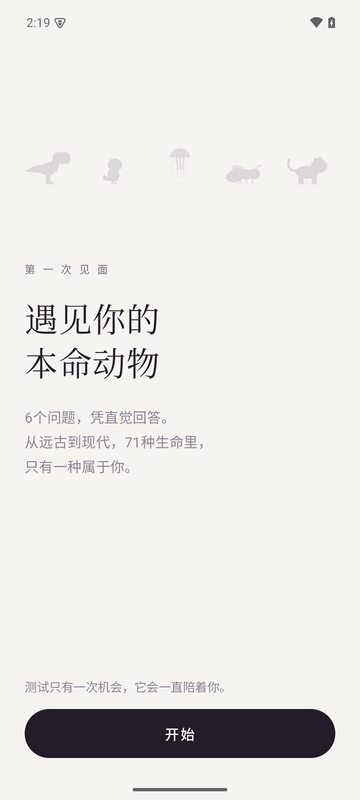
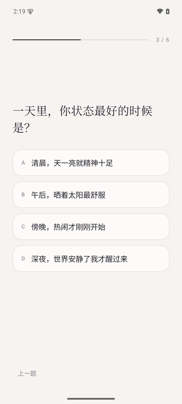
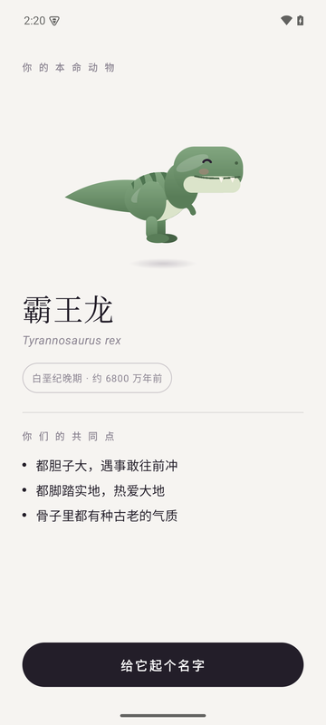
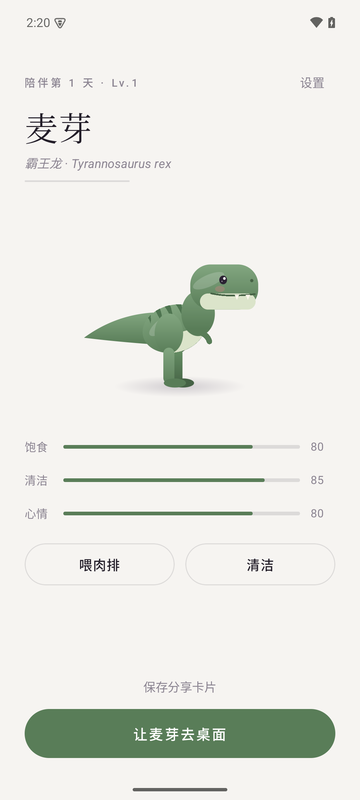
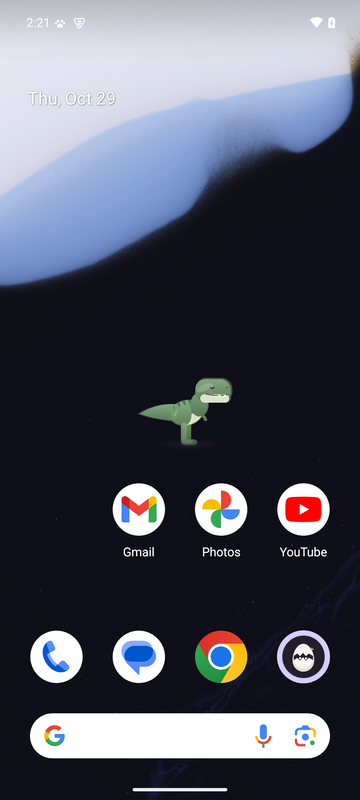
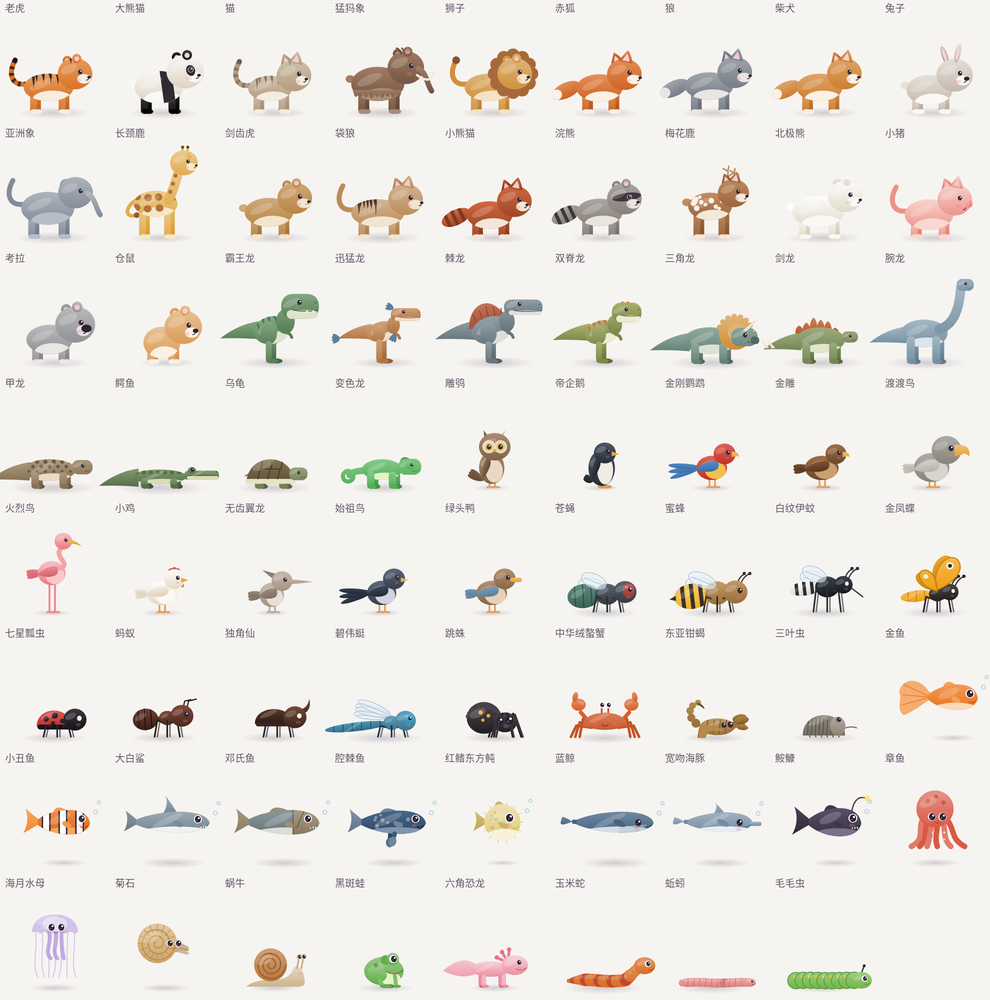

# 本命兽

回答 6 个问题，从远古到现代的 71 种生命里，找到只属于你的那一只。它会住在你的安卓桌面上：陪你走、陪你睡，偶尔飞过、游过屏幕。

**[下载页](https://fyy0619-cell.github.io/BenMingShou/)** · **[直接下载 APK](https://github.com/fyy0619-cell/BenMingShou/releases/latest)** · Android 10 及以上 · 约 2 MB · 完全离线

| 开场 | 测验 | 揭晓 | 主页 | 桌面 |
|:---:|:---:|:---:|:---:|:---:|
|  |  |  |  |  |

## 它能做什么

- **一次性测验**：6 道情境题，没有标准答案。结果从 71 种动物中产生：霸王龙、三叶虫、渡渡鸟、猛犸象，也可能是苍蝇、蚯蚓或蓝鲸。测验只有一次机会。
- **每一只都不一样**：毛色、体型和花纹由你专属的随机种子决定。另有 1% 的概率出现白化、金色或黑化的稀有个体。
- **桌面陪伴**：宠物悬浮在所有应用之上。走兽会散步，鸟和昆虫会起飞再落下，鱼和水母在屏幕上漂。点它会叫，按住可以拖动，长按回到应用。
- **养成**：饱食、清洁、心情和等级。每个物种吃的东西不同，熊猫吃竹子，霸王龙吃肉排。
- **分享卡**：生成一张「我的本命动物」卡片，保存到相册。
- **省电**：两分钟没人碰它就会睡着，之后每秒只画约 6 帧；熄屏后完全停止绘制。
- **完全离线**：没有联网权限，不收集任何信息，没有广告和统计。

## 全部 71 种



## 安装

1. 从 [Releases](https://github.com/fyy0619-cell/BenMingShou/releases/latest) 下载 `BenMingShou-x.y.z.apk`，在手机上点开安装。
2. 打开本命兽，完成测验后点「让它去桌面」，按提示开启「显示在其他应用上层」。
3. 如果开关是灰色、点不动（Android 15 及以上用安装包装的应用会这样），进入 设置 → 应用 → 本命兽，点右上角「⋮」选择「允许受限制的设置」，再回来打开。
4. 小米、华为、OPPO、vivo 等手机可能会在后台清理它。应用内「设置 → 让它不被系统清理」里有各品牌的设置方法。

## 构建

需要 JDK 21 和 Android SDK（compileSdk 37）。

```bash
./gradlew assembleDebug        # 调试包
./gradlew testDebugUnitTest    # 单元测试与截图测试，图集输出到 gallery/
bash release/package.sh        # 正式包与下载页，输出到 release/out/
```

正式签名从仓库外的 `../DeskPet-keys/keystore.properties` 读取，没有它也能构建调试包。

## 实现要点

- **动物全部用代码绘制**：10 种身体模板加上部件参数，不用一张图片素材。
- **叫声全部用代码合成**：谐波、音高曲线和包络组合而成。走系统提示音通道，手机静音时不会出声。
- **测验匹配**：对全部 4096 种答案组合做容量受限的贪心分配。71 种动物每种都能被测出，82% 的人会分到与自己最契合的前 5 名之一。
- **测试**：单元测试；Robolectric 截图测试；Android 10 和 Android 15 模拟器上的端到端测试；monkey 随机压力测试（3500 个事件，无崩溃、无 ANR）。

## 版权

© 2026 fyy0619-cell，保留所有权利。
